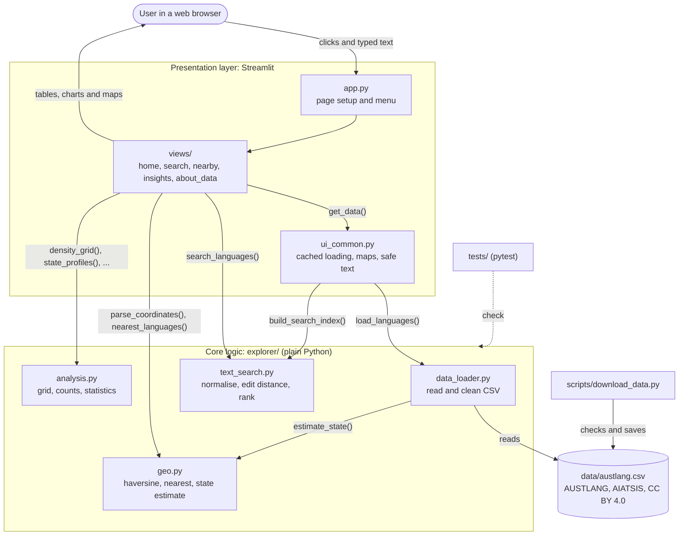

# AUSTLANG Explorer

A Streamlit web app for finding Aboriginal and Torres Strait Islander languages by
name or by place, using the AUSTLANG dataset published by AIATSIS.

Built for CITS1501 Introduction to Programming with Python (UWA), project brief
**Language and Country Explorer**.

- **Live app:** https://austlang-explorer2.streamlit.app
- **Author:** Charles Potter (25309156) and Remy Payne (25133834)

## Who it is for

Secondary school teachers and students in Western Australia, and visitors, who want
to know which languages are recorded around a place, or who have seen one language
name spelled several different ways.

## What it does

| Screen | What you can do |
| --- | --- |
| Home | See every mapped language variety and headline figures |
| Find a language | Search by any name or spelling; typos and partial names are fine; see details, the AUSTLANG link and the closest other varieties |
| Languages near a place | Paste coordinates (e.g. from Google Maps) to list the closest varieties with distance and direction |
| Insights | Density grid map, varieties per state/territory, alternative-name statistics |
| About the data | Source, licence, every cleaning step with counts, responsible use, limitations, cleaned-data download |

## Install and run

You need Python 3.10 or newer.

```bash
git clone <your-repo-url>
cd austlang-explorer
python -m venv .venv
# Windows: .venv\Scripts\activate     macOS/Linux: source .venv/bin/activate
pip install -r requirements-dev.txt
```

Get the data (one time). Open AustLang Online's data page,
<https://aiatsis.gov.au/austlang/dataResources>, leave every field ticked and click
**Download as a CSV**. Then run the script on the file, which copies it into `data/`
and checks it:

```bash
python scripts/download_data.py path/to/downloaded-file.csv
```

Start the app:

```bash
streamlit run app.py
```

It opens at <http://localhost:8501>.

## Run the tests

```bash
pytest
```

The suite has 157 automated test cases (pytest counts each parametrised case) covering
data cleaning (including both the AustLang v3 and the older file layouts), the search
algorithm, distance and direction calculations, the state estimate, the analysis
functions, invalid input, edge cases and boundary conditions.
All test data is synthetic (see `tests/fixtures/README.md`).

Manual checks of the main user workflows are in `docs/manual-testing.md`.

## Deploy

The app is deployed on Streamlit Community Cloud from this GitHub repository:

1. Make sure `data/austlang.csv` is committed (the licence allows redistribution with attribution).
2. Sign in at <https://share.streamlit.io> with GitHub and choose **Create app**.
3. Pick this repository, branch `main`, main file `app.py`, and Python 3.12 under advanced settings.
4. Deploy. Every push to `main` updates the live app.

No secrets or API keys are needed.

## Project structure

```
app.py                  page setup and navigation menu
ui_common.py            shared Streamlit code: cached data loading, maps, safe text
views/                  one file per screen
explorer/               core logic, plain Python (no Streamlit), fully tested
  models.py             Language and CleaningReport data classes, constants
  data_loader.py        reads and cleans the CSV; CSV export
  text_search.py        normalisation, Levenshtein edit distance, ranked search
  geo.py                haversine distance, bearings, coordinate parsing, nearest search, state estimate
  analysis.py           density grid, concentration, state profiles, name statistics
scripts/download_data.py  checks the downloaded dataset and saves it
data/                   austlang.csv and its README (source, licence, columns)
tests/                  pytest suite and synthetic fixture
docs/                   architecture and manual testing checklist
.streamlit/config.toml  theme; usage statistics turned off
```

## Architecture



Data flow: on first use, `ui_common.get_data()` calls `load_languages()`, which reads
the CSV, cleans each row into a `Language` object and returns a `CleaningReport`. The
result and a search index are cached, so later screens reuse them. Each screen reads
user input, validates it, calls the core functions and displays the results. See
`docs/architecture.md` for more detail.

## Main algorithms

1. **Spelling-tolerant search** (`explorer/text_search.py`). Names are normalised (accents,
   case, spaces and punctuation removed). Each spelling is classed as an exact, starts-with,
   contains or similar-spelling match; similarity uses a hand-written Levenshtein edit
   distance (dynamic programming, two rows of memory) with a length shortcut that skips
   hopeless comparisons. Each language keeps its best match; results are ranked by match
   type, score and name.
2. **Nearest varieties** (`explorer/geo.py`). The haversine formula gives the great-circle
   distance from the user's point to every mapped variety; results within the chosen
   distance are sorted (ties alphabetical) and the closest k returned with a compass direction.
3. **State estimate** (`explorer/geo.py`). A rule-based classifier using the straight state
   borders (129°E, 138°E, 141°E, 26°S, 29°S) plus interpolated lines for the QLD–NSW and
   NSW–VIC borders. Used only when AUSTLANG's own state column is missing or blank.
4. **Analysis** (`explorer/analysis.py`). Floor-division binning into a lat/long grid, the
   number of busiest squares holding half of all varieties, per-state counts and averages,
   and alternative-name statistics.

## Data, licence and responsible use

All language names, codes, alternative names and locations come from the **AUSTLANG
dataset**, Australian Institute of Aboriginal and Torres Strait Islander Studies (AIATSIS),
licensed under **CC BY 4.0**, cleaned and reformatted for this app. Details are in
`data/README.md` and on the app's About the data screen.

- AI was not used to generate any cultural, language or historical content.
- Locations are approximate points, not boundaries, and the app says so wherever it maps them.
- The app uses only published, openly licensed material; no restricted knowledge, and no
  images, voices or names of people.

## Security and privacy

- No accounts, passwords, API keys or secrets; nothing to leak in the repository (`.gitignore` also excludes `.env` and `secrets.toml`).
- No personal information is collected or stored; searches are not saved. Streamlit usage statistics are turned off in `.streamlit/config.toml`.
- All user input is validated: search text is capped at 60 characters and must contain a letter or number; coordinates are parsed strictly and range-checked; sliders limit numeric choices.
- Data is treated as untrusted when displayed: Markdown special characters are escaped, map tooltips use plain text (not HTML), and only `http`/`https` links are kept.
- The CSV download guards against spreadsheet formula injection.

## Use of AI

AI tools were used in this project as the unit permits. See `AI-LOG.md`.
