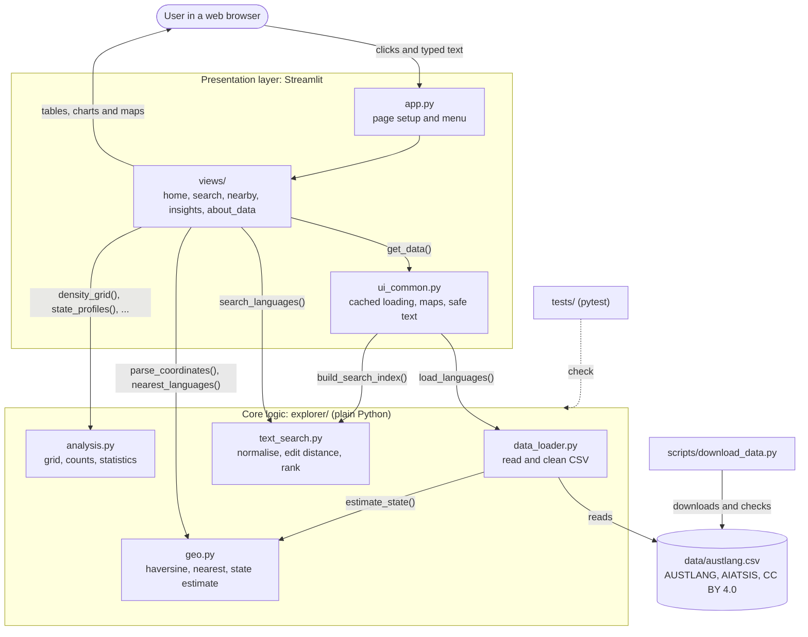

# Architecture

AUSTLANG Explorer has three layers. Each layer only talks to the one below it, so the
core logic can be tested without a browser and the screens stay short.

## Components

| Component | Responsibility |
| --- | --- |
| `app.py` | Page title, icon, wide layout; builds the navigation menu from the five screens |
| `views/*.py` | One screen each: read widgets, validate input, call core functions, show results |
| `ui_common.py` | Cached data loading (`st.cache_resource`), map layers (pydeck), Markdown escaping, labels |
| `explorer/models.py` | `Language` and `CleaningReport` data classes; constants (bounds, state names, 200-record minimum) |
| `explorer/data_loader.py` | Reads the CSV with the `csv` module, maps columns, cleans rows, produces the report; CSV export |
| `explorer/text_search.py` | Normalisation, Levenshtein distance, match classification, ranked search |
| `explorer/geo.py` | Coordinate validation and parsing, haversine distance, bearing, nearest search, state estimate |
| `explorer/analysis.py` | Density grid, concentration measure, state profiles, alternative-name statistics |
| `scripts/download_data.py` | Downloads (or accepts) the AUSTLANG CSV, runs the cleaner, records the download date |
| `tests/` | pytest suite using a synthetic fixture with deliberate data problems |

## Data flow

1. **Download (once).** `scripts/download_data.py` saves `data/austlang.csv` and `data/austlang_source.json`.
2. **Load (first visit).** A screen calls `get_data()`. On a cache miss it calls `load_languages()`,
   which reads every row, cleans it into a `Language` object and fills in a `CleaningReport`.
   `build_search_index()` normalises every spelling once. The result is cached and shared by all
   screens and visitors; the file's modification time is part of the cache key, so a new file reloads.
3. **Interact.** Each widget change reruns the current screen. The screen validates the input
   (`validate_query`, `parse_coordinates`), calls the core function (`search_languages`,
   `nearest_languages`, `density_grid`, ...) and turns the results into pandas tables, Altair
   charts and pydeck maps.
4. **Display safely.** Data values shown in Markdown are escaped, map tooltips are plain text, and
   only http/https links are rendered.
